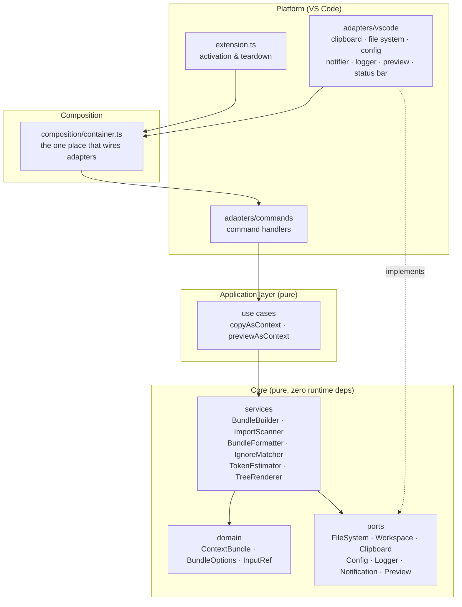
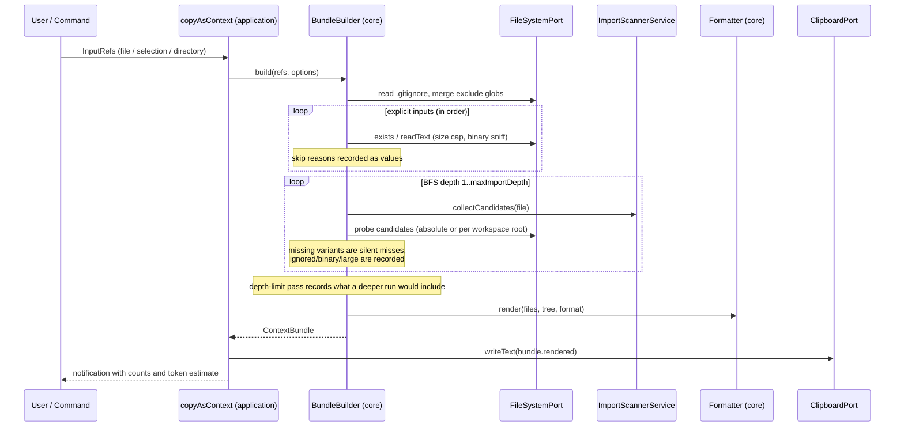

# Architecture

CodeSheaf follows a **hexagonal (ports & adapters) architecture** with an
explicit application layer. The heart of the plugin — what to bundle, how to
weave it, how to render it — knows nothing about VS Code, which is what makes
it fully unit-testable and reusable.

## Layers



Dependency direction is **inward only**:

```
extension → composition → adapters/commands → application → core → (nothing)
```

The ESLint config (`eslint.config.mjs`) enforces that `src/core/**` and
`src/application/**` never import `vscode` or anything under
`src/adapters/**` — the architecture is checked, not just documented.

## Module map

| Path                                   | Responsibility                                                                                                                                             |
| -------------------------------------- | ---------------------------------------------------------------------------------------------------------------------------------------------------------- |
| `src/core/domain/`                     | Immutable data model: `ContextBundle`, `BundledFile`, `BundleOptions`, `InputRef`, skip reasons, `BundleError`.                                            |
| `src/core/ports/`                      | Interfaces the core depends on: `FileSystemPort`, `WorkspacePort`, `ClipboardPort`, `ConfigPort`, `LoggerPort`, `NotificationPort`, `PreviewPort`.         |
| `src/core/services/bundle-builder.ts`  | The central use case: BFS over explicit inputs and import candidates, ignore pruning, directory expansion with caps, skip accounting, final assembly.      |
| `src/core/services/scan/`              | Language strategies (TS/JS, Python, Java, Go, C/C++) that turn source text into _candidate_ paths; the registry dispatches by language id, then extension. |
| `src/core/services/formatter.ts`       | Renders the bundle as Markdown / XML / plain text, with fence escalation, CDATA defusing, and optional line numbers.                                       |
| `src/core/services/ignore/`            | Pragmatic `.gitignore`-subset matcher (negation, dir-only, anchoring, `**`/`*`/`?`/`[...]`).                                                               |
| `src/core/services/token-estimator.ts` | Heuristic token estimate (4 ASCII chars ≈ 1 token, CJK ≈ 1 token per char).                                                                                |
| `src/core/services/tree-renderer.ts`   | ASCII file tree, directories first.                                                                                                                        |
| `src/core/utils/`                      | Pure helpers: comment strippers, binary sniffing, path/language mapping, formatting.                                                                       |
| `src/application/`                     | Use cases that orchestrate ports + builder: `copyAsContext`, `previewAsContext`. No VS Code imports.                                                       |
| `src/adapters/vscode/`                 | One adapter class per port, plus the status-bar `TokenMeter` controller.                                                                                   |
| `src/adapters/commands/`               | Thin handlers that translate editor/explorer state into `InputRef`s and invoke use cases.                                                                  |
| `src/composition/container.ts`         | Composition root — the only file that knows both sides.                                                                                                    |
| `src/extension.ts`                     | Activation/teardown only.                                                                                                                                  |

## Bundle weaving data flow



Key rules baked into the builder:

1. **Explicit inputs come first, in the order given**; import-discovered
   files follow in BFS discovery order.
2. **Explicit file picks bypass ignore rules** (you asked for it — like an
   `@`-mention), while **directory expansion and import discovery respect
   ignore rules**.
3. **Every skip is a value, not an exception**: `ignored`, `binary`,
   `too-large`, `not-found`, `unreadable`, `empty-selection`, `depth-limit`,
   `limit-reached`.
4. **Deduplication by normalized path** (case-insensitive on Windows hosts).
5. **Non-existent import candidates are silent** — that is how third-party
   packages and probing variants are excluded for free.

## Testing strategy

- The core and application layers are tested **without VS Code**: an
  in-memory `FileSystemPort`/`WorkspacePort` (`tests/support/fake-fs.ts`)
  makes every scenario deterministic — import chains, depth limits,
  gitignore pruning, binary/size skips, selection slicing.
- Language strategies have their own table-style tests with cross-platform
  path normalization (`C:/proj` prefixes work on Windows and Linux hosts).
- Coverage gates are configured in `vitest.config.ts`
  (`src/core/**` + `src/application/**`).
- The extension host itself is exercised only at packaging time (`vsce
package`) plus manual smoke testing via F5 (`Run CodeSheaf Extension`).

## Design rules for contributors

1. New behavior that can live in `src/core` or `src/application` **must** live
   there — adapters stay thin.
2. A new language strategy = one class + registration in
   `src/core/services/scan/strategies/index.ts` + tests. Nothing else.
3. New platform capability (e.g. diff view) = a new port + an adapter +
   a use case. Never import `vscode` above the composition root.
4. Architecturally significant decisions get an ADR under `docs/adr/`.
